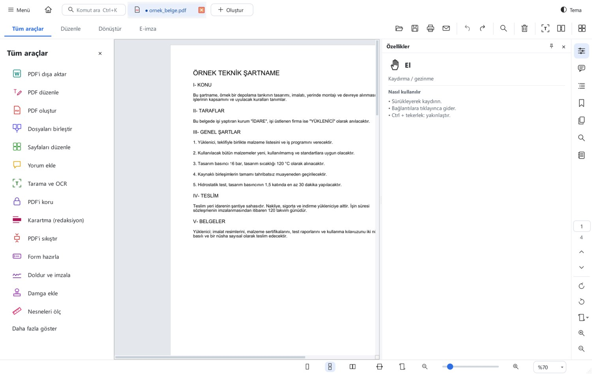
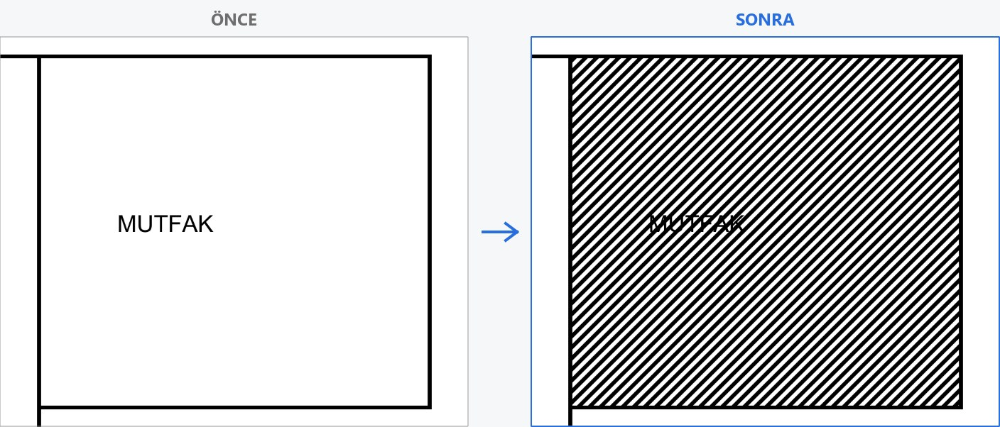
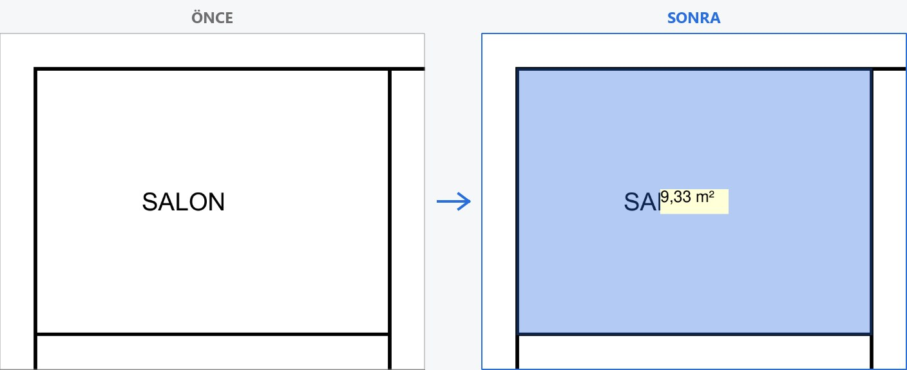
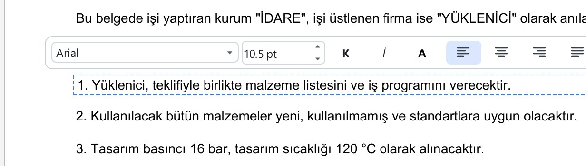
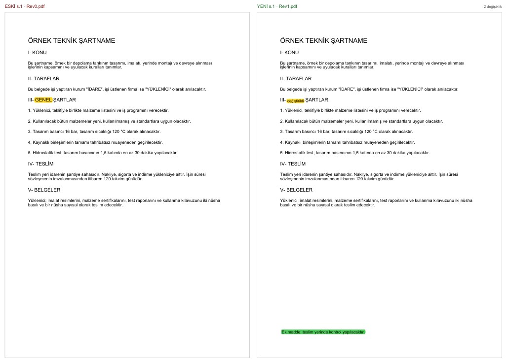
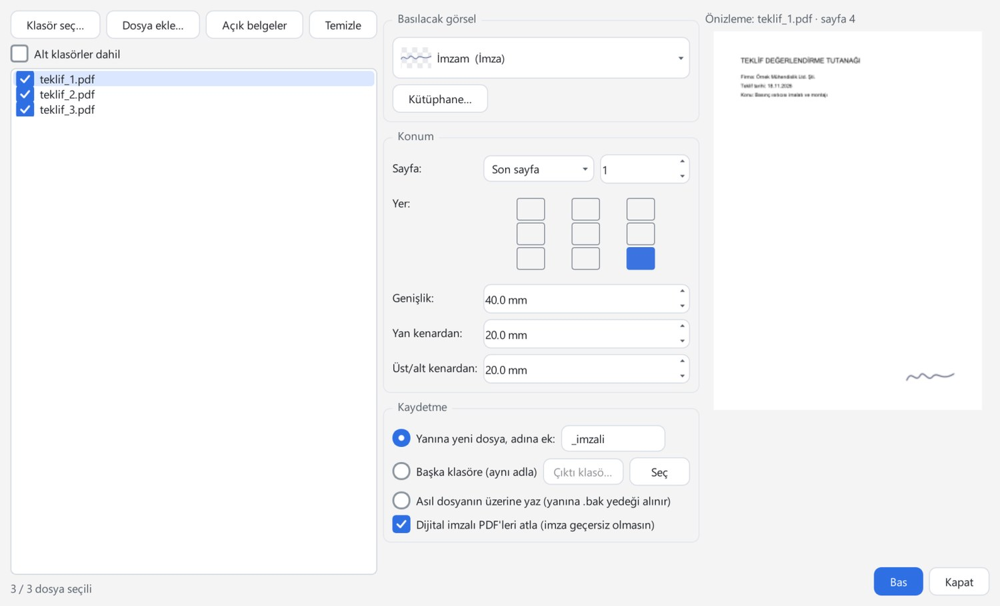
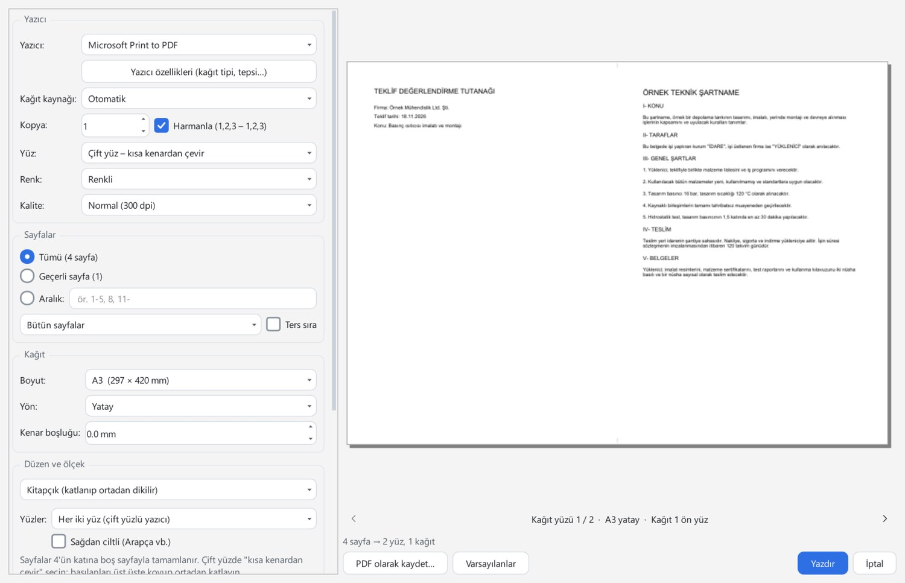
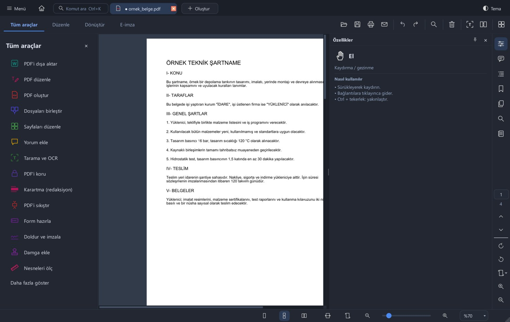

<h1 align="center">SunDayPDF</h1>

<b>Windows için ücretsiz, Türkçe PDF görüntüleyici ve düzenleyici.</b> 
PDF'i okuyun, düzenleyin, imzalayın, ölçün. Hepsi tek programda.

<a href="https://github.com/hasang476/SunDayPDF-Indir/releases/latest/download/SunDayPDF_Kurulum_1.0.exe"><b>⬇️ SunDayPDF_Kurulum_1.0.exe dosyasını indir</b></a> (yaklaşık 130 MB)
&nbsp;·&nbsp; <a href="SunDayPDF_Tanitim.pdf">📄 Tanıtım broşürü (PDF, 2 sayfa)</a>

## Neden SunDayPDF?

- **Ücretsiz ve reklamsız.** Abonelik, deneme süresi ya da filigran yok.
- **Baştan sona Türkçe.** Menüler, yardım ve arama Türkçe; ş, ğ, ı, İ aramada ve düzenlemede doğru çalışır.
- **Belgeler sizde kalır.** Dosyalar hiçbir sunucuya yüklenmez; her işlem kendi bilgisayarınızda yapılır.

## Neler yapabilir?

- PDF açma, okuma, arama; sekmeli çalışma, içindekiler (F7), aynı belgenin iki yerini yan yana görme (F8)
- Mevcut metni Word gibi yerinde düzenleme; metin, görsel, tablo, form alanı ekleme
- Vurgulama, not, çizim, ok, şekil, hazır not şablonları ve damga
- İmza, paraf ve kaşe kütüphanesi; bir klasördeki bütün PDF'lere tek seferde imza / kaşe basma
- Sayfa düzenleme: sırala, döndür, sil, böl, birleştir
- Word, Excel, PowerPoint ve görsellerden PDF; PDF'ten Word, Excel, PowerPoint, görsel
- Taranmış belgelerde Türkçe metin tanıma (OCR)
- Revizyon karşılaştırma: iki sürüm yan yana, değişen / eklenen / silinen renkli
- Hassas bilgileri bulup karartma (T.C. kimlik no, IBAN, telefon, e-posta)
- Teknik resim araçları: ölçekli mesafe, çevre ve alan ölçümü, ölçek kalibrasyonu, kesit taraması, revizyon bulutu
- Gelişmiş yazdırma: kitapçık, sayfa başına birden çok sayfa, A3, çift yüz, önizleme
- PDF/A (arşiv), şifreleme, sıkıştırma, form doldurma
- Ctrl+K komut arama, kendi kısayollarınızı atama, görselli yardım (F1)
- Temalar: açık, koyu, gece mavisi, sepya ve diğerleri

## Görüntüler

| Teknik resim: kesit taraması | Ölçekli alan ölçümü (1:50) |
|---|---|
|  |  |
| **Metni sayfanın üzerinde düzenleme** | **Revizyon karşılaştırma** |
|  |  |
| **Toplu imza / kaşe basma** | **Kitapçık yazdırma** |
|  |  |

## Kurulum

1. Yukarıdaki bağlantıdan kurulum dosyasını indirin.
2. İndirilen dosyaya çift tıklayın.
3. **"Windows bilgisayarınızı korudu"** uyarısı çıkarsa: **Ek bilgi → Yine de çalıştır**.
   (Program dijital imzalı olmadığı için Windows bu uyarıyı gösterir.)
4. Sihirbazda **İleri → Kur → Bitir** deyin. Yönetici izni gerekmez.

Kaldırmak için: **Ayarlar → Uygulamalar → SunDayPDF → Kaldır**.

Tüm sürümler: [Sürümler sayfası](https://github.com/hasang476/SunDayPDF-Indir/releases)

**Gereksinim:** Windows 10 veya 11 (64 bit). Office dönüşümleri için bilgisayarda Microsoft Office (veya LibreOffice) kurulu olmalıdır.

## Lisans

SunDayPDF ücretsizdir ve **GNU AGPL-3.0** lisansıyla dağıtılır (bkz. [LICENSE](LICENSE)).
Programın kaynak kodu her sürümün sayfasında **SunDayPDF_x.x_kaynak_kodu.zip** olarak bulunur.
İçinde kullanılan açık kaynak bileşenler: [UCUNCU_TARAF_LISANSLAR.txt](UCUNCU_TARAF_LISANSLAR.txt).

Görüntülerdeki belgeler tanıtım için hazırlanmış örnek belgelerdir.

Geliştiren: Hasan Gündüz
